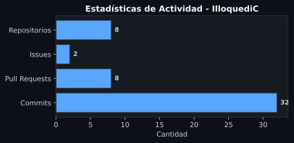

<h1 align="center">¡Qué pasa, bro! 👋 Bienvenido a mi perfil secundario</h1>

  
  

---

# 🚀 Sobre mí

Soy un apasionado del desarrollo de software, la ingeniería inversa y la seguridad en dispositivos móviles. En este espacio centralizo forks, herramientas de auditoría y proyectos experimentales enfocados en el ecosistema Android y utilidades de alto rendimiento.

---

# 🛠️ Tecnologías y Herramientas

   &nbsp;&nbsp;
   &nbsp;&nbsp;
   &nbsp;&nbsp;
   &nbsp;&nbsp;
   &nbsp;&nbsp;
   &nbsp;&nbsp;
  

---

# 📌 Repositorios Destacados

*   **[DemoniTalk-Pro](https://github.com/illoquediC/DemoniTalk-Pro)**: Versión avanzada optimizada y reconstruida con Flutter y motor nativo en Rust para comandos de voz y accesibilidad.
*   
*   **[HexRootScan](https://github.com/illoquediC/HexRootScan)**: Herramienta potente de auditoría de redes y pruebas de penetración diseñada exclusivamente para dispositivos Android.

---

# 📊 Estadísticas de GitHub

  

