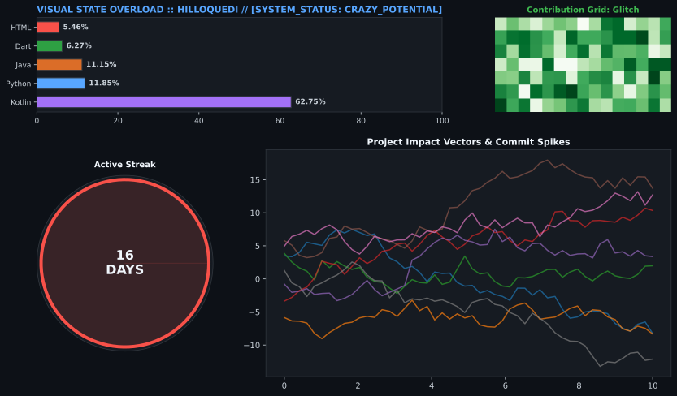

<h1 align="center">¡Qué pasa, bro! 👋 Bienvenido a mi perfil secundario</h1>

  
  

---

# 🚀 Sobre mí

Soy un apasionado del desarrollo de software, la ingeniería inversa y la seguridad en dispositivos móviles. En este espacio centralizo forks, herramientas de auditoría y proyectos experimentales enfocados en el ecosistema Android y utilidades de alto rendimiento.

---

# 🛠️ Tecnologías y Herramientas

   &nbsp;&nbsp;
   &nbsp;&nbsp;
   &nbsp;&nbsp;
   &nbsp;&nbsp;
   &nbsp;&nbsp;
   &nbsp;&nbsp;
  

---

# 📌 Repositorios Destacados

*   **[DemoniTalk-Pro](https://github.com/illoquediC/DemoniTalk-Pro)**: Versión avanzada optimizada y reconstruida con Flutter y motor nativo en Rust para comandos de voz y accesibilidad.
*   
*   **[HexRootScan](https://github.com/illoquediC/HexRootScan)**: Herramienta potente de auditoría de redes y pruebas de penetración diseñada exclusivamente para dispositivos Android.

<!-- APP_SHOWCASE_START -->

<table width="100%" align="center" bgcolor="#030B12" style="border: 1px solid #FFD600; background-color: #030B12; padding: 2px;" cellspacing="5" cellpadding="0">
<tr>
<td width="50%" valign="top" align="center">
<h2>😈 Dark Tools 😈</h2>
<b>Root &nbsp;·&nbsp; Pentesting &nbsp;·&nbsp; Android</b>
  
<table align="center" cellspacing="4" cellpadding="0">
<tr>
<td align="center" bgcolor="#FFD600" style="border: 1px solid #FFD600; background-color: #FFD600; padding: 2px;">

</td>
<td align="center" bgcolor="#030B12" style="border: 1px solid #FFD600; background-color: #030B12; padding: 2px;">

</td>
<td align="center" bgcolor="#030B12" style="border: 1px solid #FFD600; background-color: #030B12; padding: 2px;">

</td>
<td align="center" bgcolor="#030B12" style="border: 1px solid #FFD600; background-color: #030B12; padding: 2px;">

</td>
</tr>
<tr>
<td align="center" bgcolor="#030B12" style="border: 1px solid #FFD600; background-color: #030B12; padding: 2px;">

</td>
<td align="center" bgcolor="#030B12" style="border: 1px solid #FFD600; background-color: #030B12; padding: 2px;">

</td>
<td align="center" bgcolor="#030B12" style="border: 1px solid #FFD600; background-color: #030B12; padding: 2px;">

</td>
<td align="center" bgcolor="#030B12" style="border: 1px solid #FFD600; background-color: #030B12; padding: 2px;">

</td>
</tr>
</table>
</td>

<td width="50%" valign="top" align="center">
<h2>📱 General Apps 📱</h2>
<b>Utilities &nbsp;·&nbsp; Accessibility &nbsp;·&nbsp; Science</b>
  
<table align="center" cellspacing="4" cellpadding="0">
<tr>
<td align="center" bgcolor="#030B12" style="border: 1px solid #FFD600; background-color: #030B12; padding: 2px;">

</td>
<td align="center" bgcolor="#030B12" style="border: 1px solid #FFD600; background-color: #030B12; padding: 2px;">

</td>
<td align="center" bgcolor="#030B12" style="border: 1px solid #FFD600; background-color: #030B12; padding: 2px;">

</td>
<td align="center" bgcolor="#030B12" style="border: 1px solid #FFD600; background-color: #030B12; padding: 2px;">

</td>
</tr>
<tr>
<td align="center" bgcolor="#030B12" style="border: 1px solid #FFD600; background-color: #030B12; padding: 2px;">

</td>
<td align="center" bgcolor="#030B12" style="border: 1px solid #FFD600; background-color: #030B12; padding: 2px;">

</td>
<td align="center" bgcolor="#030B12" style="border: 1px solid #FFD600; background-color: #030B12; padding: 2px;">

</td>
<td align="center">&nbsp;</td>
</tr>
</table>
</td>
</tr>
</table>

<!-- APP_SHOWCASE_END -->

---

# 📊 Estadísticas de GitHub

  

  

